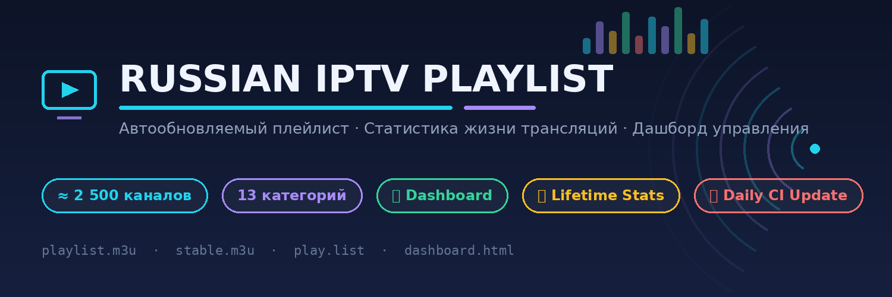
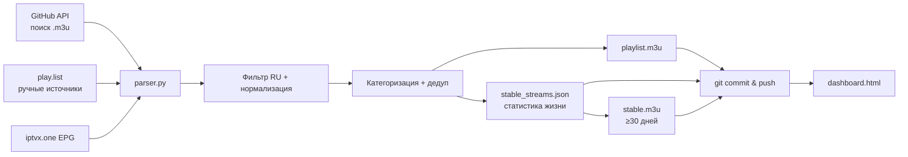

<div align="center">



<br/>

[](../../actions/workflows/update-russian-iptv.yml)
[](playlist.m3u)
[](#-категории-плейлиста)
[](LICENSE)
[](dashboard.html)

**Полностью автоматизированный конвейер, который каждый день собирает, фильтрует и категоризирует русскоязычные IPTV-трансляции со всего GitHub, ведёт статистику «жизни» каждой ссылки и предоставляет веб-дашборд для управления всеми списками.**

</div>

---

## ✨ Особенности

| | |
|---|---|
| 🤖 **Автообновление** | GitHub Actions запускает сборку ежедневно в 03:00 UTC и коммитит свежие списки |
| 🔍 **Поиск источников** | Автоскан GitHub API на новые `.m3u`-плейлисты + ваши ручные источники в `play.list` |
| 🇷🇺 **Русский фильтр** | Отбор каналов по EPG (`iptvx.one`) и эвристикам — только русскоязычные трансляции |
| 🗂 **Категоризация** | Тематические группы с эмодзи: кино, спорт, детские, новости, 4K и др. |
| ⏱ **Статистика жизни** | Для каждой ссылки хранится период жизни, архив умираний/возвращений, счётчик появлений |
| 🧘 **Стабильные ссылки** | Отдельный `stable.m3u` из потоков, живущих ≥ 30 дней — самые надёжные |
| 🎛 **Веб-дашборд** | Интерфейс управления: статистика, редактор источников, просмотрщик плейлистов |
| 🚫 **Умная дедупликация** | Удаление битых/заглушечных URL, склейка альтернативных имён одного потока |

---

## 📂 Структура репозитория

```
.
├── parser.py               # Конвейер: сбор → фильтрация → категоризация → статистика жизни
├── play.list               # Список источников (ручные + авто-найденные, формат M3U-подобный)
├── playlist.m3u            # Итоговый плейлист (~2500 каналов, все категории)
├── stable.m3u              # Только стабильные ссылки (период жизни ≥ 30 дней)
├── stable_streams.json     # База статистики: история появления/исчезновения каждого URL
├── dashboard.html          # 🎛 Веб-дашборд управления (self-contained, без сервера)
├── assets/
│   └── header.png          # Баннер репозитория
└── .github/workflows/
    └── update-russian-iptv.yml   # Ежедневный CI: python parser.py → commit & push
```

---

## 🚀 Быстрый старт

### Использовать плейлист

Скопируйте ссылку в любой IPTV-плеер (VLC, OTT Navigator, IPTV Smarters, Tivimate):

```
https://raw.githubusercontent.com/<OWNER>/<REPO>/main/playlist.m3u
```

EPG-гид уже прописан внутри плейлиста: `url-tvg="https://iptvx.one/epg/epg.xml.gz"`

### Запустить локально

```bash
pip install requests
python parser.py
```

### Открыть дашборд

```bash
# Вариант 1: GitHub Pages (Settings → Pages → Deploy from branch: main /)
# https://<owner>.github.io/<repo>/dashboard.html

# Вариант 2: локально
python -m http.server 8000
# http://localhost:8000/dashboard.html
```

Дашборд умеет загружать данные напрямую из любого репозитория через `raw.githubusercontent.com`, а изменения можно экспортировать обратно файлами для коммита.

---

## ⏱ Статистика жизни трансляций

Каждый прогон конвейера отслеживает **каждую уникальную ссылку потока**:

```jsonc
// stable_streams.json — запись одной трансляции
{
  "url": "http://example.com/stream.ts",
  "name": "Первый канал",
  "category": "📺 Федеральные и Общие",
  "first_seen": "2026-01-01",      // первое появление
  "current_birth": "2026-01-01",   // начало ТЕКУЩЕГО периода жизни
  "last_seen": "2026-02-18",       // последняя видимость
  "alive": true,
  "appearances": 2,                // сколько раз появлялась (с возвратами)
  "histories": [                   // архив завершённых периодов жизни
    {"start": "2026-01-01", "end": "2026-02-10", "days": 41}
  ]
}
```

**Правила жизненного цикла** (константы в начале `parser.py`):

| Константа | Значение | Смысл |
|---|---|---|
| `STABLE_MISSING_TOLERANCE` | `7` дней | Пропажа ≤ 7 дней — временный сбой, период жизни не прерывается |
| `STABLE_DAYS_MIN` | `30` дней | Порог «стабильности» для включения в `stable.m3u` |

В `stable.m3u` каждая запись несёт метку периода жизни:

```
# LIVE-DAYS: 49 | SINCE: 2026-01-01 | APPEARANCES: 1
#EXTINF:-1 tvg-id="..." group-title="..." tvg-lifetime="49",Имя канала
http://стабильная-ссылка/stream.ts
```

---

## 🎛 Дашборд

`dashboard.html` — одностраничное приложение без зависимостей. Четыре вкладки:

- **📊 Обзор** — счётчики, гистограмма периодов жизни, топ-10 долгожителей, лента смертей за 3 дня
- **📡 Трансляции** — таблица всех ссылок: поиск, фильтры, сортировка, история каждой, исключение
- **🔗 Источники** — редактор `play.list`: ручные URL, чекбоксы авто-источников, живой предпросмотр
- **📄 Плейлисты** — просмотр/редактирование `playlist.m3u` и `stable.m3u`, массовое удаление, экспорт

> Данные подтягиваются автоматически при открытии с GitHub Pages; исключения хранятся в localStorage браузера и применяются к экспортируемым файлам.

---

## 🗂 Категории плейлиста

| Категория | Каналов |
|---|---:|
| 📦 Разное | 1773 |
| 🎬 Кино и Сериалы | 161 |
| 📺 Федеральные и Общие | 122 |
| ⚽ Спорт | 97 |
| 🎵 Музыка | 96 |
| 📺 4K / Ultra HD | 64 |
| 🌍 Познавательные | 62 |
| 🏛 Региональные каналы | 37 |
| 🧸 Детские | 35 |
| 📰 Новости | 19 |
| 🌿 Природа, Охота, Рыбалка | 12 |
| 🚗 Авто и Мото | 8 |
| 🍳 Еда и Кулинария | 5 |
| 💊 Здоровье и Медицина | 3 |
| ✝️ Религиозные | 3 |
| 🛍 Шопинг · 🚂 Транспорт | 2 |

---

## ⚙️ Как это работает



1. **Сбор** — загружается EPG, читаются источники из `play.list` + автоскан GitHub Search
2. **Фильтрация** — остаются только русскоязычные каналы; отбрасываются заглушки и мусорные URL
3. **Категоризация** — категория берётся из EPG, при отсутствии — по ключевым словам имени канала
4. **Жизненный цикл** — каждая ссылка получает ID (`md5`), ведётся период жизни и архив исчезновений
5. **Публикация** — обновлённые файлы коммитятся ботом; дашборд показывает актуальное состояние

---

## ❓ FAQ

**Как добавить свой источник?**
Откройте дашборд → вкладка «Источники», добавьте URL и скачайте `play.list` для коммита (или отредактируйте файл вручную).

**Как удалить нерабочий канал?**
Дашборд → «Трансляции» → кнопка 🚫 на строке. Исключение сохранится в браузере и применится к экспортированным `stable.m3u`/плейлистам.

**Каналы пишут «нужна подписка» — как избавиться?**
Фильтрация работает на двух уровнях:
1. **По тексту плейлиста** — `parser.py` отсекает каналы-заглушки по имени/URL ещё при парсинге
   (список фраз — `SUBSCRIPTION_PATTERNS`, легко дополнить) и вычищает готовые
   `playlist.m3u`/`stable.m3u` при каждом прогоне.
2. **Живая проверка потока** — если канал выглядит «чистым», а при открытии плеер показывает
   картинку «Требуется подписка», это видно только по содержимому HTTP-потока. Конвейер
   параллельно опрашивает ссылки (HEAD→GET): код 402/403, HTML/PNG вместо видео или текст
   о подписке в ответе — канал исключается с указанием причины в логе CI. Хосты, отдавшие
   ≥3 заглушек подряд, попадают в чёрный список (экономия времени). Выключить проверку:
   `SUBSCRIPTION_URL_CHECK = False` в начале блока проверки в `parser.py`.

В дашборде есть фильтр «💳 Нужна подписка» и кнопка 💳 на строке — ею можно вручную
пометить ссылку «в потоке заглушка» (метка хранится в браузере), после чего исключить её 🚫.

**Почему много каналов в «Разное»?**
Эвристики категоризации несовершенны для источников без EPG-соответствия — категория уточняется при появлении данных в гиде.

**Когда появятся данные о жизни ссылок?**
При первом прогоне все ссылки получают период жизни 1 день; значимая статистика накапливается за ~месяц ежедневных запусков.

---

## 📜 Лицензия

MIT — используйте свободно. Исходные плейлисты принадлежат их авторам.

---

<div align="center">


**Сделано с ❤️ для сообщества русскоязычного IPTV** · [⬆ Наверх](#-russian-iptv-playlist)

</div>
